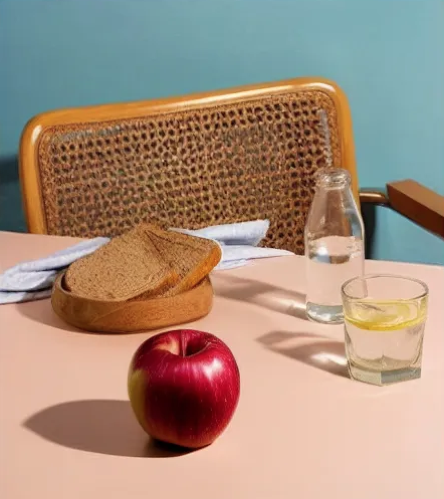
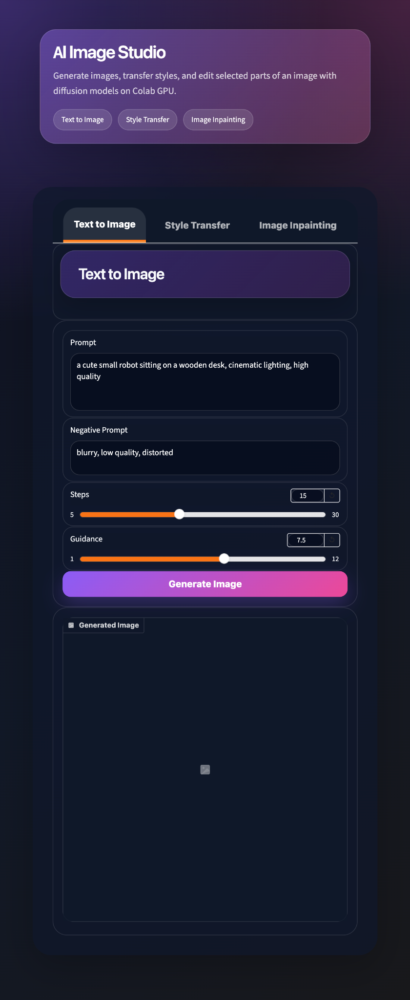
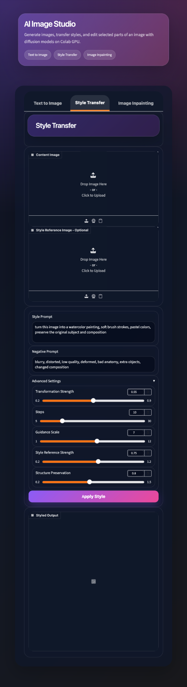
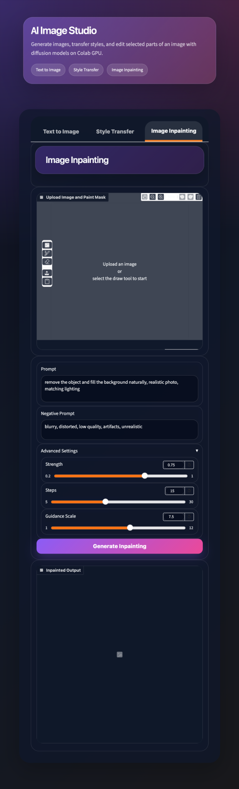

# AI Image Studio

**An interactive image generation and editing application powered by Stable Diffusion, ControlNet, IP-Adapter, and Gradio.**

[Explore the notebook](notebooks/AI_Image_Studio.ipynb) · [View application source](src/app.py) · [See generated examples](examples)

## Overview

AI Image Studio combines three diffusion-based workflows in a single Gradio interface:

- **Text-to-image generation:** create images from text prompts using Stable Diffusion.
- **Style transfer:** transform an input image while guiding its structure with Canny edges and ControlNet, with optional IP-Adapter reference-image conditioning.
- **Image inpainting:** edit selected regions of an input image using a painted mask and a text prompt.

The project was developed and tested as a notebook-based application using a GPU runtime. The standalone Python script in `src/app.py` was extracted for easier code review, but has not yet been independently validated end to end.

## Generated results

These images are example outputs from the original project. They are shown separately from interface screenshots so the outputs remain easy to inspect.

| Text-to-image | Style transfer | Image inpainting |
|:---:|:---:|:---:|
|  |  |  |

## Application interface

The Gradio application has three dedicated tabs. The following captures show the interface layout, input controls, and configurable generation settings; the output panels were empty when these interface screenshots were taken. Generated examples are presented above.

<details>
<summary><strong>1. Text to Image — prompt-based generation</strong></summary>



</details>

<details>
<summary><strong>2. Style Transfer — image references and structural guidance</strong></summary>



</details>

<details>
<summary><strong>3. Image Inpainting — mask-guided editing</strong></summary>



</details>

## Technical approach

| Workflow | Main components |
|---|---|
| Text to image | Stable Diffusion, text prompts, diffusion-step and guidance controls |
| Style transfer | ControlNet with Canny conditioning; optional IP-Adapter image reference; configurable transformation strength |
| Inpainting | Mask-based editing with a Stable Diffusion inpainting pipeline |
| User interface | Gradio tabs and input controls |
| Model management | Lazy pipeline loading and memory cleanup when switching tasks |

**Stack:** Python, PyTorch, Hugging Face Diffusers, Transformers, Gradio, OpenCV, NumPy, Pillow.

### Pretrained model identifiers

- Base model: `Lykon/dreamshaper-8`
- ControlNet: `lllyasviel/sd-controlnet-canny`
- IP-Adapter: `h94/IP-Adapter` (`ip-adapter_sd15.bin`)
- Inpainting: `runwayml/stable-diffusion-inpainting`

Weights are downloaded separately and are **not** included in this repository. Verify the licenses and access requirements of each pretrained model before use.

## How to run

A GPU-enabled environment with enough VRAM is recommended. The original notebook was run in a hosted GPU environment; on a CPU-only computer, diffusion inference can be very slow or impractical.

### Option A — notebook (original workflow)

Open [`notebooks/AI_Image_Studio.ipynb`](notebooks/AI_Image_Studio.ipynb) in a GPU-backed notebook environment, install dependencies using the setup cells, and execute the notebook in order. The notebook includes an optional Hugging Face authentication step if model access requires it.

**Note:** Gradio is configured with `share=False`; accessing a remotely hosted UI may require environment-specific configuration. Do not enable public sharing without reviewing model terms and safety settings.

### Option B — standalone Python script (not yet fully re-tested)

```bash
python -m venv .venv
source .venv/bin/activate   # macOS / Linux
pip install -r requirements.txt
python src/app.py
```

On Windows, the activation command differs. Dependency versions in `requirements.txt` have not yet been pinned to a fully reproduced environment, so compatibility may vary.

## Repository structure

```text
ai-image-studio/
├── README.md
├── requirements.txt
├── .gitignore
├── src/
│   └── app.py
├── notebooks/
│   └── AI_Image_Studio.ipynb
├── examples/
│   ├── text_to_image_result.png
│   ├── style_transfer_result1.png
│   └── inpainting_result.png
└── docs/
    └── screenshots/
        ├── text_to_image_ui.png
        ├── style_transfer_ui.png
        └── inpainting_ui.png
```

## Limitations and next steps

- **Reproducibility:** the standalone `src/app.py` was syntax-checked, but its diffusion pipelines have not been re-run end to end following extraction from the original notebook. Dependency versions should be pinned after a clean-environment test.
- **Safety:** some original model pipelines disable the safety checker. Safety safeguards and model terms should be reviewed before any public-facing deployment.
- **Assets:** ensure that all displayed examples and any source images used in demonstrations can be redistributed.
- **Performance:** large model downloads and GPU memory requirements can make local execution impractical on CPU-only machines.

## Author

**Reyhaneh Rezaei** — M.Sc. student in Artificial Intelligence, Ferdowsi University of Mashhad.

*Academic portfolio project. No code license has been selected yet.*
